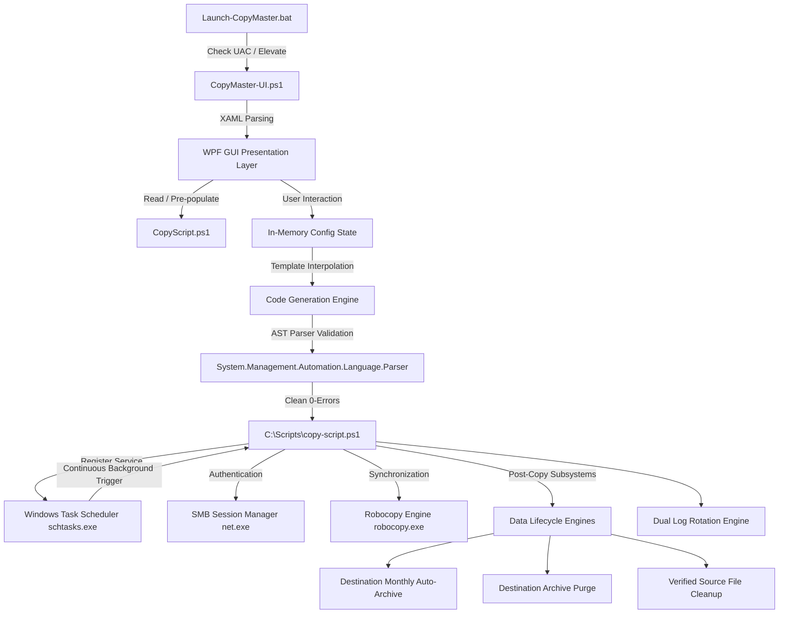

# Copy Master - Developer & Architecture Guide

> **Technical Reference, Component Architecture & Internals**  
> For software engineers, systems programmers, and automation developers maintaining or extending the Copy Master codebase.

---

## 🏗 High-Level System Architecture



---

## 📁 Repository Structure & Roles

| Directory / File | Language | Purpose | Runtime Context |
| :--- | :--- | :--- | :--- |
| **Launch-CopyMaster.bat** | Windows Batch | Root menu launcher; starts either Modern Go TUI or Legacy PowerShell GUI. | Interactive CLI |
| **go/** | Go 1.26 (Charm) | Modern, air-gapped standalone suite built with Bubble Tea, Bubbles, Lip Gloss, and Huh. Cross-compiled for Windows and Linux. | Standalone Binary (copymaster.exe) |
| **legacy/** | PowerShell 5.1 / WPF | Original Windows PowerShell 5.1 & WPF desktop GUI implementation. | Elevated Administrator (powershell.exe) |
| **README.md** | Markdown | Comprehensive Operator & User Guide. | Documentation |
| **DEVELOPER.md** | Markdown | Technical architecture, component specifications, and developer manual (this file). | Documentation |neers, systems programmers, and automation developers maintaining or extending the Copy Master codebase.

---

## 🏗 High-Level System Architecture


---

## 📁 Repository Structure & Roles

| File | Language | Purpose | Runtime Context |
| :--- | :--- | :--- | :--- |
| **`Launch-CopyMaster.bat`** | Windows Batch | Bootstrap launcher; performs UAC detection and auto-elevation to Administrator. | Interactive user context |
| **`CopyMaster-UI.ps1`** | PowerShell 5.1 / WPF | Standalone desktop GUI, event handlers, DataGrid state manager, template generator, and syntax validator. | Elevated Administrator (`powershell.exe`) |
| **`CopyScript.ps1`** | PowerShell 5.1 | Standalone reference script and fallback template containing complete replication and lifecycle logic. | Manual CLI or scheduled task |
| **`Install-Task.ps1`** | PowerShell 5.1 | Headless CLI script installer for registering `CopyScript.ps1` in Task Scheduler without opening the GUI. | Elevated CLI |
| **`Test-CopyMaster-E2E.ps1`** | PowerShell 5.1 | Automated End-to-End regression & validation suite testing code generation, Robocopy sync, lifecycle policies, and loop prevention. | Developer CLI / CI |
| **`README.md`** | Markdown | Comprehensive Operator & User Guide. | Documentation |
| **`DEVELOPER.md`** | Markdown | Technical architecture, component specifications, and developer manual (this file). | Documentation |

---

## 🧩 Detailed Component Specifications

### 1. Presentation Layer (WPF via Native PowerShell)
- **Framework**: Built on `System.Windows.PresentationFramework` and `System.Windows.Markup.XamlReader`.
- **Zero Compilation**: The entire XAML UI is embedded directly as an XML string inside `CopyMaster-UI.ps1`. This ensures it runs instantly on any Windows workstation without Visual Studio, MSBuild, or .NET SDK installation.
- **Dynamic Control Binding**:
  ```powershell
  $reader = [System.Xml.XmlNodeReader]::new($xaml)
  $window = [System.Windows.Markup.XamlReader]::Load($reader)
  foreach ($name in $namedElements) {
      Set-Variable -Name $name -Value ($window.FindName($name))
  }
  ```
- **Reactive DataGrid**: The mappings table uses `System.Collections.ObjectModel.ObservableCollection[PSCustomObject]`. Rows added, modified, or removed immediately reflect in the DataGrid without full UI redrawing.
- **Modal Confirmations**: Deletion policies trigger `[System.Windows.MessageBox]::Show(..., [MessageBoxButton]::YesNo, [MessageBoxImage]::Warning)` with event cancellation if rejected.

---

### 2. Template Generation & AST Validation Engine
- **Single-Quoted Template Interpolation**: The replication script template is stored inside `@' ... '@` (single-quoted here-string). This prevents PowerShell from prematurely evaluating variables, subexpressions `$()`, or backticks during generation.
- **Token Replacement**: Specific placeholders (`__TOKEN__`) are interpolated safely via `.Replace()`:
  - `__SOURCE_USERNAME__`, `__SOURCE_PASSWORD__`
  - `__FOLDER_MAPPINGS__`
  - `__LOG_FOLDER__`, `__MAX_LOG_MB__`, `__RETENTION_DAYS__`, `__POLLING_SEC__`
  - `__ENABLE_SOURCE_DELETE__`, `__SOURCE_DELETE_DAYS__`
  - `__ENABLE_DEST_ARCHIVE__`
  - `__ENABLE_DEST_DELETE__`, `__DEST_DELETE_MONTHS__`
- **PowerShell 5.1 Parser Compatibility (Trailing Comma Protection)**:
  In PowerShell 5.1, an array literal ending with a trailing comma before `)` (e.g. `@( @{ ... }, )`) causes a fatal `Missing expression after ','` parse error. The generator handles the final mapping with index boundary checks:
  ```powershell
  if ($i -lt ($mappingCount - 1)) {
      $mappingsBuilder.AppendLine('    },') | Out-Null
  } else {
      $mappingsBuilder.AppendLine('    }') | Out-Null
  }
  ```
- **Automated AST Validation**: Before saving any script to disk, `Save-ReplicationScript` runs:
  ```powershell
  $parseErrors = $null
  [System.Management.Automation.Language.Parser]::ParseInput($content, [ref]$null, [ref]$parseErrors) | Out-Null
  if ($parseErrors -and $parseErrors.Count -gt 0) {
      # Intercept and abort save
  }
  ```

---

### 3. SMB Session Manager (`Connect-SourceShare`)
- **Root Share Resolution**:
  Given subfolder paths like `\\10.91.13.204\qw\Test1\Sub`, the engine parses the root UNC share:
  ```powershell
  $parts = $UNCPath.TrimStart('\').Split('\')
  $root = "\\$($parts[0])\$($parts[1])" # Results in \\10.91.13.204\qw
  ```
- **Non-Persistent Credential Mounting**:
  ```powershell
  cmd.exe /c "net use `"$root`" /delete /y" *> $null
  cmd.exe /c "net use `"$root`" /user:`"$SourceUsername`" `"$SourcePassword`" /persistent:no" *> $null
  ```
- **Drive-Letter Independence**: Avoids mounting network drives to letters (`Z:`, `Y:`) which can collide in multi-user or service environments.

---

### 4. Robocopy Replication Engine (`Start-RobocopyCopy`)
- **Argument Vector**:
  ```powershell
  $Arguments = @(
      "`"$SourcePath`"",
      "`"$DestPath`""
  )
  # Dynamic File Filters (e.g. *.csv)
  # Industrial Options:
  #   /E       - Copy subdirectories, including empty ones
  #   /Z       - Restartable mode (survives network interruptions)
  #   /FFT     - Assume FAT file times (2-second granularity for industrial CIFS)
  #   /XO      - Exclude older files (skips unchanged files)
  #   /R:5     - 5 retries on locked/busy files
  #   /W:15    - 15 seconds wait between retries
  #   /NP /TEE - Suppress progress %, mirror output to console
  #   /LOG+:   - Append detailed log
  #   /XD 20*  - Exclude monthly archive folders (2026-09, etc.)
  ```
- **Loop Exclusion (`/XF`)**:
  When destination monthly archiving is enabled, files already archived in `DestPath\YYYY-MM\` are dynamically collected and passed via `/XF <filename> ...` to prevent Robocopy from re-copying files that were moved out of the destination root.
- **Process Spawning**:
  Invoked via `Start-Process -FilePath "robocopy.exe" -ArgumentList $Arguments -Wait -NoNewWindow -PassThru`.
- **Exit Code Evaluation**:
  Robocopy uses a bitmask. The engine evaluates:
  - `ExitCode <= 7`: Non-fatal synchronization success.
  - `ExitCode >= 8`: Serious error (logged as failure).

---

### 5. Lifecycle Subsystems

#### Subsystem A: Destination Monthly Auto-Archive (`Invoke-DestinationMonthlyArchive`)
- **Objective**: Move files from completed previous months into `YYYY-MM` directories.
- **Month Boundary Calculation**:
  ```powershell
  $now = Get-Date
  $currentMonthStart = [DateTime]::new($now.Year, $now.Month, 1, 0, 0, 0)
  ```
  *Note*: Milliseconds must be explicitly zeroed to prevent precision mismatch bugs when comparing with `LastWriteTime`.
- **Execution**:
  For each file at `$DestPath` root:
  If `$file.LastWriteTime -lt $currentMonthStart`:
  1. Determine archive folder name: `$file.LastWriteTime.ToString("yyyy-MM")`.
  2. Create directory if missing: `New-Item -ItemType Directory -Path "$DestPath\$ym" -Force`.
  3. Move file: `Move-Item -LiteralPath $file.FullName -Destination "$DestPath\$ym\$($file.Name)" -Force`.

#### Subsystem B: Historical Destination Purge (`Invoke-DestinationArchivePurge`)
- **Objective**: Purge `YYYY-MM` directories older than $X$ months.
- **Cutoff Calculation**:
  ```powershell
  $cutoffMonth = $currentMonthStart.AddMonths(-$DestArchiveDeleteMonths)
  ```
- **Discovery**: Scans `$DestPath` directories matching regex `^\d{4}-(0[1-9]|1[0-2])$`.
- **Purge Action**:
  If `[DateTime]::ParseExact($folder.Name, "yyyy-MM", $null) -lt $cutoffMonth`:
  Permanently removes directory tree via `Remove-Item -LiteralPath $folder.FullName -Recurse -Force`.

#### Subsystem C: Verified Remote Source Cleanup (`Invoke-SourceCleanup`)
- **Objective**: Free up storage on remote machine controllers without risk of data loss.
- **Cutoff Calculation**: `$cutoff = (Get-Date).AddDays(-$SourceDeleteDays)`.
- **Dual-Location Verification Algorithm**:
  ```
  Does File Exist at Dest Root?
       ├── YES: Check (DestLength == SourceLength)
       │         └── MATCH: Verified -> Safe to Delete from Source
       │         └── MISMATCH: Skipped -> Pending Copy
       │
       └── NO: Does File Exist in Dest Monthly Archive (Dest\YYYY-MM\File)?
                 ├── YES: Check (ArchiveLength == SourceLength)
                 │         └── MATCH: Verified -> Safe to Delete from Source
                 │         └── MISMATCH: Skipped -> Pending Copy
                 │
                 └── NO: Skipped -> Never copied to destination
  ```
- Files that do not meet verification criteria are never deleted from source.

---

### 6. Logging & Rotation Subsystem (`Rotate-SingleLog` & `Cleanup-OldLogs`)
- **Atomic Rotation**: When active log size exceeds `MaxLogSizeMB` (default: 10 MB):
  1. Renames active log to `Robocopy_YYYYMMDD_HHMMSS.log`.
  2. Recreates empty active log.
  3. Keeps up to `MaxArchivedLogs` (default: 20) newest archives and prunes older ones.
- **Time Retention**: Prunes any log file older than `LogRetentionDays` (default: 30 days).

---


---

## 🛡️ Go Standalone Architecture & EDR False-Positive Mitigation

To satisfy enterprise industrial security requirements where host intrusion detection systems (EDR) monitor script execution, Copy Master provides a complete, statically compiled Go implementation alongside the PowerShell GUI configurator.

### Component Structure (cmd/ & internal/)

`
copymaster/
├── cmd/
│   └── copymaster/
│       ├── main.go                       # CLI entry point, flag parser, signal handler
│       ├── console_windows.go            # Windows console double-click detector
│       ├── console_other.go              # Non-windows console fallback
│       ├── versioninfo.json              # Windows PE metadata definition
│       └── resource_windows_amd64.syso   # Compiled Windows PE resource & manifest
├── internal/
│   ├── config/                           # YAML config loader, serializer & validator
│   ├── engine/
│   │   ├── engine.go                     # Cycle runner and background daemon scheduler
│   │   ├── replicator.go                 # File synchronization with Robocopy /XO /FFT semantics
│   │   └── lifecycle.go                  # Monthly auto-archive, archive purge, verified cleanup
│   ├── logger/                           # Thread-safe dual logger with dynamic listener & rotation
│   ├── protocol/
│   │   ├── fs.go                         # Virtual File System (VFS) interface
│   │   ├── local.go                      # Native OS filesystem & Windows UNC implementation
│   │   └── sftp.go                       # In-process pure Go SFTP/SSH implementation
│   └── tui/                              # Air-Gapped Terminal User Interface (TUI)
│       ├── app.go                        # Main interactive TUI application & layout (tview)
│       ├── modals.go                     # Overlay modals (Connection test, SSH wizard, Guide)
│       ├── guide.go                      # Multi-protocol remote server setup guide generator
│       ├── sshkeygen.go                  # Air-gapped Ed25519 SSH keypair generator & saver
│       └── script_parser.go              # Parser to import from PowerShell scripts or YAML
├── build/
│   ├── Build-Binaries.ps1                # Automated Windows build script with test execution
│   └── build.sh                          # Automated Linux/macOS cross-compilation script
└── bin/
    ├── copymaster.exe                    # Windows 64-bit standalone executable (~6.7 MB)
    ├── copymaster-linux-amd64            # Linux x86_64 statically linked binary (~6.5 MB)
    └── copymaster-linux-arm64            # Linux ARM64 statically linked binary (~6.1 MB)
`

### Air-Gapped Terminal User Interface (TUI) Architecture

The interactive TUI runs entirely inside the terminal screen buffer using github.com/rivo/tview and github.com/gdamore/tcell/v2:
- **100% Air-Gapped**: Opens zero network ports, launches no web browser, and requires no external graphical server.
- **Section 1: Protocol & Endpoint Authentication Form**: Allows configuring Protocol (SFTP, SCP, SMB, FTPS, FTP, WebDAV, Local), direction (Push, Pull, Local), Host, Port, Username, Password, and SSH Key.
- **Section 2: Folder Mappings Table**: Interactive table with row selection, status toggling, and input fields to add/remove mappings.
- **Section 3: Data Lifecycle & Scheduler Policies**: Configures verified source deletion, monthly archiving (YYYY-MM), archive purging, daemon intervals, and log retention.
- **Section 4: Live Auditing Console**: Real-time streaming log display capturing operational messages and replication progress with color-coded severity.
- **Wizards & Modals**:
  - SSH Key Wizard: Generates native Ed25519 key pairs and saves them with appropriate permissions.
  - Server Setup Guide: Displays protocol-specific firewall and uthorized_keys instructions.
  - Test Connection: Asynchronously verifies network reachability and credentials.
  - Import / Open: Automatically loads and converts configuration from existing PowerShell replication scripts or YAML files.
- **Keyboard Navigation**:
  - Tab / Shift-Tab: Cycle focus between input forms, tables, and console.
  - F2: Trigger immediate replication cycle (Run Sync Now).
  - F3: Save active configuration to YAML.
  - F4: Test remote connection.
  - F5: Open / load existing configuration or script.
  - F6: Display Remote Server Setup Guide.
  - F7: Launch SSH Key Wizard.
  - F10: Exit application cleanly.
### EDR False-Positive Prevention Principles

| Risk Vector in Script Automations | How Copy Master (Go Edition) Solves It |
| :--- | :--- |
| **Command-Line Credential Visibility** | `net.exe use \share /user:admin pass` exposes credentials in process command lines. In Go, SMB and SFTP authentication occurs entirely in-process memory without launching external commands. |
| **Script Execution Policy Alerts** | Calling `powershell.exe -ExecutionPolicy Bypass` triggers heuristic script-block logging and EDR alerts. The Go binary compiles directly to native machine code. |
| **Anonymous / Unknown PE Flags** | Bare compiled binaries lack PE version tags. Copy Master embeds standard `VersionInfo` resources (`CompanyName`, `FileDescription`, `LegalCopyright`, `ProductVersion`) and an application manifest (`requestedExecutionLevel level="asInvoker"`). |
| **High Entropy / Packer Signatures** | Malware packers (such as UPX) trigger heuristic antivirus flags. Copy Master is distributed uncompressed with normal entropy. |
| **Partial / Incomplete Write Failures** | File transfers write to `.tmp` files with byte flushing (`Sync()`) and timestamp preservation (`Chtimes`) before atomic renaming. |

## 🛠 Testing & Validation Procedures

### 1. Static Syntax & AST Check
Run on any script in the repository:
```powershell
$errors = $null
[System.Management.Automation.Language.Parser]::ParseFile("CopyMaster-UI.ps1", [ref]$null, [ref]$errors)
if ($errors) { $errors | ForEach-Object { Write-Error $_ } } else { "Syntax Clean!" }
```

### 2. Headless Script Generation Test
Verify that the UI template engine produces clean code:
```powershell
# In PowerShell:
$content = Get-Content -Raw "CopyMaster-UI.ps1"
# Test parsing
[System.Management.Automation.Language.Parser]::ParseInput($content, [ref]$null, [ref]$errs)
$errs.Count # Must be 0
```

### 3. Automated End-to-End (E2E) Test Suite
The repository includes a comprehensive, 21-point automated test suite: [`Test-CopyMaster-E2E.ps1`](file:///c:/Projects/Companies/Copy Master/Copy-Script/Test-CopyMaster-E2E.ps1).

#### Running in Local Sandbox Mode (Default - Zero Network Required):
```powershell
.\Test-CopyMaster-E2E.ps1
```
- Creates an isolated sandbox under `C:\temp\CopyMaster_E2E_Test\`.
- Generates test files across three simulated timeframes (today, last month, >30 days ago) and pre-creates expired/retained archive directories.
- Extracts the UI template, performs AST validation, and executes Pass 1 replication.
- Validates 8 post-replication lifecycle assertions (file movement, pruning, byte-verified source deletion).
- Executes Pass 2 to verify that Robocopy loop prevention exclusions (`/XD 20*`, `/XF`) prevent re-copying archived files.
- Audits log generation and content.
- Automatically cleans up the sandbox upon completion.

#### Running Against a Live SMB Share:
```powershell
.\Test-CopyMaster-E2E.ps1 -RemoteUNC "\\10.91.13.204\qw\E2E_Test" -Username "10.91.13.204\admin" -Password "SecretPass123"
```

#### Preserving Sandbox Files for Inspection:
```powershell
.\Test-CopyMaster-E2E.ps1 -KeepTestFiles
```

---

## 💡 Guidelines for Extending the Codebase

1. **Maintain Zero External Dependencies**: Do not introduce NuGet packages, node modules, or third-party DLLs. All functionality must execute using built-in Windows PowerShell 5.1 and standard Windows system utilities.
2. **Preserve Air-Gap Isolation**: Do not add telemetry, web requests, or online verification endpoints.
3. **Preserve Documentation Integrity**: Update `README.md` and this document whenever configuration parameters or lifecycle behaviors are modified.
4. **Safety-First Deletions**: Any new deletion logic must require explicit user opt-in and verification against target destination files before executing `Remove-Item`.
