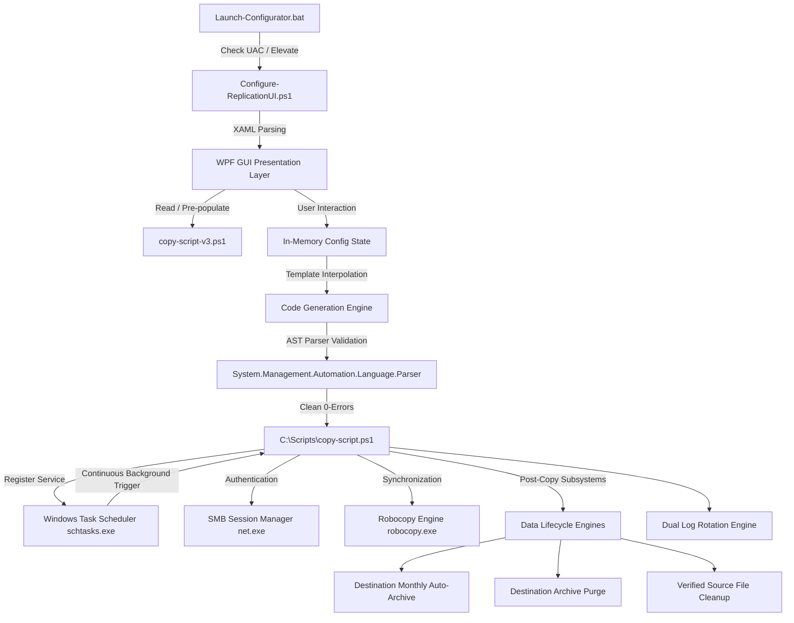

# Avgol Copy Master - Developer & Architecture Guide

> **Technical Reference, Component Architecture & Internals**  
> For software engineers, systems programmers, and automation developers maintaining or extending the Avgol Copy Master codebase.

---

## 🏗 High-Level System Architecture



---

## 📁 Repository Structure & Roles

| File | Language | Purpose | Runtime Context |
| :--- | :--- | :--- | :--- |
| **`Launch-Configurator.bat`** | Windows Batch | Bootstrap launcher; performs UAC detection and auto-elevation to Administrator. | Interactive user context |
| **`Configure-ReplicationUI.ps1`** | PowerShell 5.1 / WPF | Standalone desktop GUI, event handlers, DataGrid state manager, template generator, and syntax validator. | Elevated Administrator (`powershell.exe`) |
| **`copy-script-v3.ps1`** | PowerShell 5.1 | Standalone reference script and fallback template containing complete replication and lifecycle logic. | Manual CLI or scheduled task |
| **`Install-RobocopyTask.ps1`** | PowerShell 5.1 | Headless CLI script installer for registering `copy-script-v3.ps1` in Task Scheduler without opening the GUI. | Elevated CLI |
| **`README.md`** | Markdown | Comprehensive Operator & User Guide. | Documentation |
| **`DEVELOPER.md`** | Markdown | Technical architecture, component specifications, and developer manual (this file). | Documentation |

---

## 🧩 Detailed Component Specifications

### 1. Presentation Layer (WPF via Native PowerShell)
- **Framework**: Built on `System.Windows.PresentationFramework` and `System.Windows.Markup.XamlReader`.
- **Zero Compilation**: The entire XAML UI is embedded directly as an XML string inside `Configure-ReplicationUI.ps1`. This ensures it runs instantly on any Windows workstation without Visual Studio, MSBuild, or .NET SDK installation.
- **Dynamic Control Binding**:
  ```powershell
  $reader = [System.Xml.XmlNodeReader]::new($xaml)
  $window = [System.Windows.Markup.XamlReader]::Load($reader)
  foreach ($name in $namedElements) {
      Set-Variable -Name $name -Value ($window.FindName($name))
  }
  ```
- **Reactive DataGrid**: The mappings table uses `System.Collections.ObjectModel.ObservableCollection[PSCustomObject]`. Rows added, modified, or removed immediately reflect in the DataGrid without full UI redrawing.
- **Modal Confirmations**: Deletion policies trigger `[System.Windows.MessageBox]::Show(..., [MessageBoxButton]::YesNo, [MessageBoxImage]::Warning)` with event cancellation if rejected.

---

### 2. Template Generation & AST Validation Engine
- **Single-Quoted Template Interpolation**: The replication script template is stored inside `@' ... '@` (single-quoted here-string). This prevents PowerShell from prematurely evaluating variables, subexpressions `$()`, or backticks during generation.
- **Token Replacement**: Specific placeholders (`__TOKEN__`) are interpolated safely via `.Replace()`:
  - `__SOURCE_USERNAME__`, `__SOURCE_PASSWORD__`
  - `__FOLDER_MAPPINGS__`
  - `__LOG_FOLDER__`, `__MAX_LOG_MB__`, `__RETENTION_DAYS__`, `__POLLING_SEC__`
  - `__ENABLE_SOURCE_DELETE__`, `__SOURCE_DELETE_DAYS__`
  - `__ENABLE_DEST_ARCHIVE__`
  - `__ENABLE_DEST_DELETE__`, `__DEST_DELETE_MONTHS__`
- **PowerShell 5.1 Parser Compatibility (Trailing Comma Protection)**:
  In PowerShell 5.1, an array literal ending with a trailing comma before `)` (e.g. `@( @{ ... }, )`) causes a fatal `Missing expression after ','` parse error. The generator handles the final mapping with index boundary checks:
  ```powershell
  if ($i -lt ($mappingCount - 1)) {
      $mappingsBuilder.AppendLine('    },') | Out-Null
  } else {
      $mappingsBuilder.AppendLine('    }') | Out-Null
  }
  ```
- **Automated AST Validation**: Before saving any script to disk, `Save-ReplicationScript` runs:
  ```powershell
  $parseErrors = $null
  [System.Management.Automation.Language.Parser]::ParseInput($content, [ref]$null, [ref]$parseErrors) | Out-Null
  if ($parseErrors -and $parseErrors.Count -gt 0) {
      # Intercept and abort save
  }
  ```

---

### 3. SMB Session Manager (`Connect-SourceShare`)
- **Root Share Resolution**:
  Given subfolder paths like `\\10.91.13.204\qw\Test1\Sub`, the engine parses the root UNC share:
  ```powershell
  $parts = $UNCPath.TrimStart('\').Split('\')
  $root = "\\$($parts[0])\$($parts[1])" # Results in \\10.91.13.204\qw
  ```
- **Non-Persistent Credential Mounting**:
  ```powershell
  cmd.exe /c "net use `"$root`" /delete /y" *> $null
  cmd.exe /c "net use `"$root`" /user:`"$SourceUsername`" `"$SourcePassword`" /persistent:no" *> $null
  ```
- **Drive-Letter Independence**: Avoids mounting network drives to letters (`Z:`, `Y:`) which can collide in multi-user or service environments.

---

### 4. Robocopy Replication Engine (`Start-RobocopyCopy`)
- **Argument Vector**:
  ```powershell
  $Arguments = @(
      "`"$SourcePath`"",
      "`"$DestPath`""
  )
  # Dynamic File Filters (e.g. *.csv)
  # Industrial Options:
  #   /E       - Copy subdirectories, including empty ones
  #   /Z       - Restartable mode (survives network interruptions)
  #   /FFT     - Assume FAT file times (2-second granularity for industrial CIFS)
  #   /XO      - Exclude older files (skips unchanged files)
  #   /R:5     - 5 retries on locked/busy files
  #   /W:15    - 15 seconds wait between retries
  #   /NP /TEE - Suppress progress %, mirror output to console
  #   /LOG+:   - Append detailed log
  #   /XD 20*  - Exclude monthly archive folders (2026-09, etc.)
  ```
- **Loop Exclusion (`/XF`)**:
  When destination monthly archiving is enabled, files already archived in `DestPath\YYYY-MM\` are dynamically collected and passed via `/XF <filename> ...` to prevent Robocopy from re-copying files that were moved out of the destination root.
- **Process Spawning**:
  Invoked via `Start-Process -FilePath "robocopy.exe" -ArgumentList $Arguments -Wait -NoNewWindow -PassThru`.
- **Exit Code Evaluation**:
  Robocopy uses a bitmask. The engine evaluates:
  - `ExitCode <= 7`: Non-fatal synchronization success.
  - `ExitCode >= 8`: Serious error (logged as failure).

---

### 5. Lifecycle Subsystems

#### Subsystem A: Destination Monthly Auto-Archive (`Invoke-DestinationMonthlyArchive`)
- **Objective**: Move files from completed previous months into `YYYY-MM` directories.
- **Month Boundary Calculation**:
  ```powershell
  $now = Get-Date
  $currentMonthStart = [DateTime]::new($now.Year, $now.Month, 1, 0, 0, 0)
  ```
  *Note*: Milliseconds must be explicitly zeroed to prevent precision mismatch bugs when comparing with `LastWriteTime`.
- **Execution**:
  For each file at `$DestPath` root:
  If `$file.LastWriteTime -lt $currentMonthStart`:
  1. Determine archive folder name: `$file.LastWriteTime.ToString("yyyy-MM")`.
  2. Create directory if missing: `New-Item -ItemType Directory -Path "$DestPath\$ym" -Force`.
  3. Move file: `Move-Item -LiteralPath $file.FullName -Destination "$DestPath\$ym\$($file.Name)" -Force`.

#### Subsystem B: Historical Destination Purge (`Invoke-DestinationArchivePurge`)
- **Objective**: Purge `YYYY-MM` directories older than $X$ months.
- **Cutoff Calculation**:
  ```powershell
  $cutoffMonth = $currentMonthStart.AddMonths(-$DestArchiveDeleteMonths)
  ```
- **Discovery**: Scans `$DestPath` directories matching regex `^\d{4}-(0[1-9]|1[0-2])$`.
- **Purge Action**:
  If `[DateTime]::ParseExact($folder.Name, "yyyy-MM", $null) -lt $cutoffMonth`:
  Permanently removes directory tree via `Remove-Item -LiteralPath $folder.FullName -Recurse -Force`.

#### Subsystem C: Verified Remote Source Cleanup (`Invoke-SourceCleanup`)
- **Objective**: Free up storage on remote machine controllers without risk of data loss.
- **Cutoff Calculation**: `$cutoff = (Get-Date).AddDays(-$SourceDeleteDays)`.
- **Dual-Location Verification Algorithm**:
  ```
  Does File Exist at Dest Root?
       ├── YES: Check (DestLength == SourceLength)
       │         └── MATCH: Verified -> Safe to Delete from Source
       │         └── MISMATCH: Skipped -> Pending Copy
       │
       └── NO: Does File Exist in Dest Monthly Archive (Dest\YYYY-MM\File)?
                 ├── YES: Check (ArchiveLength == SourceLength)
                 │         └── MATCH: Verified -> Safe to Delete from Source
                 │         └── MISMATCH: Skipped -> Pending Copy
                 │
                 └── NO: Skipped -> Never copied to destination
  ```
- Files that do not meet verification criteria are never deleted from source.

---

### 6. Logging & Rotation Subsystem (`Rotate-SingleLog` & `Cleanup-OldLogs`)
- **Atomic Rotation**: When active log size exceeds `MaxLogSizeMB` (default: 10 MB):
  1. Renames active log to `Robocopy_YYYYMMDD_HHMMSS.log`.
  2. Recreates empty active log.
  3. Keeps up to `MaxArchivedLogs` (default: 20) newest archives and prunes older ones.
- **Time Retention**: Prunes any log file older than `LogRetentionDays` (default: 30 days).

---

## 🛠 Testing & Validation Procedures

### 1. Static Syntax & AST Check
Run on any script in the repository:
```powershell
$errors = $null
[System.Management.Automation.Language.Parser]::ParseFile("Configure-ReplicationUI.ps1", [ref]$null, [ref]$errors)
if ($errors) { $errors | ForEach-Object { Write-Error $_ } } else { "Syntax Clean!" }
```

### 2. Headless Script Generation Test
Verify that the UI template engine produces clean code:
```powershell
# In PowerShell:
$content = Get-Content -Raw "Configure-ReplicationUI.ps1"
# Test parsing
[System.Management.Automation.Language.Parser]::ParseInput($content, [ref]$null, [ref]$errs)
$errs.Count # Must be 0
```

### 3. End-to-End Simulation
To simulate replication, archiving, purging, and cleanup locally without an external SMB share:
1. Create mock source and destination folders:
   ```powershell
   New-Item -ItemType Directory -Path "C:\temp\TestSim\Source", "C:\temp\TestSim\Dest" -Force
   "data" | Set-Content "C:\temp\TestSim\Source\sample.csv"
   (Get-Item "C:\temp\TestSim\Source\sample.csv").LastWriteTime = (Get-Date).AddMonths(-2)
   ```
2. Run `copy-script-v3.ps1` targeting these directories with `$EnableSourceDelete = $true` and `$EnableDestMonthlyArchive = $true`.
3. Verify that `sample.csv` moves to `C:\temp\TestSim\Dest\YYYY-MM\sample.csv` and deletes from `C:\temp\TestSim\Source\`.

---

## 💡 Guidelines for Extending the Codebase

1. **Maintain Zero External Dependencies**: Do not introduce NuGet packages, node modules, or third-party DLLs. All functionality must execute using built-in Windows PowerShell 5.1 and standard Windows system utilities.
2. **Preserve Air-Gap Isolation**: Do not add telemetry, web requests, or online verification endpoints.
3. **Preserve Documentation Integrity**: Update `README.md` and this document whenever configuration parameters or lifecycle behaviors are modified.
4. **Safety-First Deletions**: Any new deletion logic must require explicit user opt-in and verification against target destination files before executing `Remove-Item`.
